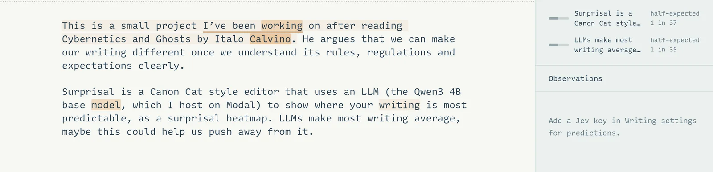

# Surprisal

Surprisal shows where your writing is most predictable for an LLM, as a
heatmap. It never writes for you.

It is deeply inspired by the writing machine in Italo Calvino's Cybernetics and
Ghosts. When you know the rules, regulations and expectations you're meeting,
you can think to write differently. LLMs make most writing average, Surprisal
pushes away from it.

The model is Qwen3 4B Base, hosted on Modal.

Try it at https://surprisal.ink



## How it works

- **Heatmap.** Warm words are ones the model would have written itself.
  Underlines are phrases it would write exactly. Each sentence is rated
  expected, half-expected or unexpected.
- **Rules.** Write rules as plain sentences anywhere on the page with
  `@rules - a rule`. We pass each paragraph to Jev and leave observations when
  rules are broken. Rules need a Jev key, Surprisal works without one.
- **One page.** Jef Raskin's Canon Cat and iA Writer are our inspirations for
  the editor. Your writing and rules are all on one page, with Markdown,
  sections, Leap and variants.

Your writing is saved in your browser, not synced. Surprisal sends the current
and previous paragraph to the model, and rules send nearby writing to Jev.

## Run your own

It runs on Cloudflare Workers, deployed with [Alchemy](https://alchemy.run).
You need [Bun](https://bun.sh), a Cloudflare account and a Modal account.

1. Run `bun install`, then `modal deploy scorer.py`.
2. Set `CLOUDFLARE_API_TOKEN`, `CLOUDFLARE_ACCOUNT_ID` and `SCORER_URL` (the URL
   Modal printed). Add `SURPRISAL_DOMAIN` for a domain on your Cloudflare
   account.
3. Run `bun run deploy`. It prints a `scorerPublicKey`.
4. Put that key in `PUBLIC_KEYS` in `scorer.py` and run `modal deploy scorer.py`
   again.

The editor's font, Codelia, is licensed and not in this repo. Put your own
`codelia.otf` in `public/`, or it falls back to your system's monospace.

## Code

- `frontend/` the editor, in React and CodeMirror
- `index.ts` and `backend/` the Worker's API: `/api/surprisal` and
  `/api/annotate`
- `shared/` parsing and scoring used by both
- `alchemy.run.ts` the Worker, its D1 database and the scorer's signing key
- `scorer.py` the Modal app that runs the model

```sh
bun run check
```
